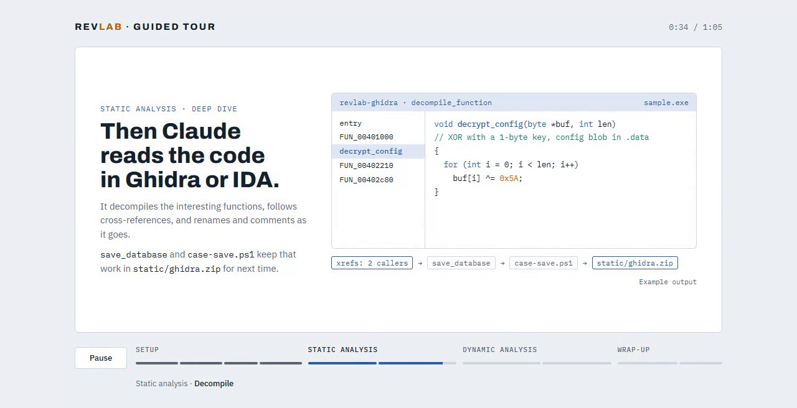

# vmware-rev-lab

A reverse engineering and malware analysis lab on VMware Workstation, built to
be driven by Claude Code. One Windows 10 22H2 + FLARE-VM guest does both static
and dynamic analysis on an isolated network; the host controls it through
PowerShell scripts and three MCP servers:

- `vmware-mcp`: power, snapshots, guest files and processes, screenshots.
- `revlab-ghidra`: Ghidra 12 (re-mcp) running in the guest.
- `revlab-windbg`: WinDbg `cdb` (mcp-windbg) running in the guest.

The Ghidra and WinDbg servers reach the host over VMCI vSockets, so the guest
never needs a network path to the host.

## Tour

[](docs/media/revlab-tour.mp4)

A one-minute walkthrough: setup, then a case through static analysis,
dynamic analysis, results and reset. Click the image to open the video
(`docs/media/revlab-tour.mp4`). Tool output in the video is example data.

## Requirements

- Windows host with VMware Workstation 17 or newer.
- PowerShell 7.2+ (`pwsh`), `git` and Python 3.10+ on `PATH`.
- 120 GB free on the drive that holds the VM.
- Internet access during setup (Windows ISO, FLARE-VM, tool packages).
- Pester 5.5+ to run the unit tests.

## Setup

1. Check `lab.config.psd1`. The settings you are most likely to change are
   `VmxPath`, `Cpu`, `MemoryMB`, `DiskGB` and `VmwareDir`.
2. Run setup from the repository root:

   ```powershell
   pwsh -File setup.ps1                       # downloads the Windows 10 evaluation ISO
   pwsh -File setup.ps1 -IsoPath D:\iso\win10.iso   # or use your own (SHA256 must match IsoSha256)
   ```

   Setup takes several hours (the FLARE-VM install alone is the longest
   part). It runs these phases in order and records progress in
   `.lab/state.json`, so it can be rerun after a failure and skips completed
   phases:

   `Preflight`, `Mcp`, `Iso`, `AnswerIso`, `CreateVm`, `WindowsInstall`,
   `GuestPrep`, `FlareVm`, `AnalysisConfig`, `McpBridge`, `Snapshot`

   To rerun from a given phase: `pwsh -File setup.ps1 -From GuestPrep`.
3. When it finishes you have:
   - the VM at `VmxPath`, on an isolated network, with a `clean` snapshot
     (powered on, logged in; set `SnapshotPoweredOff = $true` in
     `lab.config.psd1` to save a RAM-sized `.vmem` at the cost of a guest boot
     on every revert, applied at the next snapshot retake such as
     `net.ps1 -Mode Analysis -UpdateSnapshot`);
   - `lab.local.psd1` with the generated guest password, ISO path and
     current snapshot name (not committed);
   - `.mcp.json` registering the three MCP servers for Claude Code;
   - `tools/vmware-mcp/` with the pinned vmware-mcp and its venv.
4. Start Claude Code in the repository root and approve the project MCP
   servers.

If `GuestPrep` stops because Defender or Tamper Protection is still on, turn
off Tamper Protection in the VM console (Windows Security > Virus & threat
protection > Manage settings), then run `pwsh -File setup.ps1 -From GuestPrep`.

To rebuild from scratch, delete the VM in VMware and `.lab/state.json`, then
run `setup.ps1` again.

## Adding tools

The guest ships a lean, CLI-first FLARE-VM package set
(`templates/flare-config.xml`). To install more FLARE-VM / Chocolatey
packages:

```powershell
pwsh -File scripts/add-tool.ps1 -Package goresym.vm, pycdc.vm
```

The script reverts to the clean snapshot, gives the guest Internet (NAT),
installs the packages, refreshes `C:\lab\tools-index.txt`, switches back to
the isolated network and retakes the clean snapshot. Because it opens the
guest to the Internet, only a person runs it, never Claude.

Useful packages by sample type:

| Sample | Package |
|---|---|
| Go | `goresym.vm` |
| PyInstaller / Python bytecode | `pycdc.vm`, `pylingual.vm` |
| AutoIt | `autoit-ripper.vm` |
| Delphi | `idr.vm` |
| Electron | `asar.vm` |
| Obfuscated JavaScript | `js-deobfuscator.vm` |
| Manual GUI work | `x64dbg.vm`, `dnspyex.vm`, `idafree.vm` |

If an install fails, the guest is left on NAT. Fix it and rerun, or discard
the changes with `pwsh -File scripts/net.ps1 -Mode Analysis`.

## Basic usage

### Start a session

The VM must be running before Claude Code starts. `revlab-ghidra` and
`revlab-windbg` are host-side bridges to relays inside the guest; if the VM is
off they time out and Claude Code marks them as failed. Nothing starts the VM
automatically; a SessionStart hook (`scripts/check-vm.ps1`) only warns you
when Claude Code starts and the VM is off.

```powershell
pwsh -File scripts/reset.ps1   # revert to the clean snapshot and start the VM
claude                         # then start Claude Code in the repository root
```

Check with `/mcp` that `vmware-mcp`, `revlab-ghidra` and `revlab-windbg` are
connected. If Claude Code was already open, or a server dropped after a
revert, reconnect it from `/mcp`; the guest relays need about 30 seconds after
a revert.

### Create a case

Put the sample in a password-protected zip (password `infected`) under
`cases/<case>/sample.zip`. Case names may contain letters, digits, `.`, `_`
and `-`. Never extract or run the sample on the host.

```
cases/<case>/
  sample.zip      # the sample, zipped with password "infected"
  notes.md        # your findings
  static/         # saved Ghidra work (ghidra.zip)
  fetched/        # files brought back from the guest
  runs/<ts>/      # detonation results
```

### Static analysis

```powershell
pwsh -File scripts/case-open.ps1 -Case <case>   # stages the sample in C:\lab\in\sample
```

Then work through `revlab-ghidra` (`open_database`, `wait_for_analysis`,
`decompile_function`, renames, comments) or run CLI tools in the guest
(`Diec`, `Capa`, `Floss`, `Ilspycmd`, ...; paths are in `C:\lab\tools.json`).
Call `save_database` after edits, then:

```powershell
pwsh -File scripts/case-save.ps1 -Case <case>   # stores the work in cases/<case>/static/ghidra.zip
```

### Dynamic analysis

```powershell
pwsh -File scripts/detonate.ps1 -Case <case> [-Timeout 120] [-Sample <name>] [-SampleArgs "..."] [-Export <fn>] [-KeepRunning]
```

Reverts to clean, runs the sample with Procmon, Sysmon and FakeNet-NG,
collects the results into `cases/<case>/runs/<ts>/text/` (`procmon.csv`,
`fakenet/fakenet.log`, `sysmon.json`, `processes.txt`) and reverts again
unless `-KeepRunning` is given.

### Debugging

```powershell
pwsh -File scripts/debug.ps1 -Case <case>                      # sample stopped under cdb, no monitors
pwsh -File scripts/detonate.ps1 -Case <case> -UnderDebugger    # same, with monitors
```

Attach from `revlab-windbg` with `open_cdb_remote` and
`npipe:server=.,pipe=revlab-dbg`. Finish with `scripts/reset.ps1` (after
`debug.ps1`) or `scripts/collect.ps1 -Case <case>` (after `-UnderDebugger`).

### CTF cases with Internet

Some challenges need the guest online (a remote challenge server, `pip install`
of a solver dependency). Give that case an Internet policy:

```powershell
pwsh -File scripts/case-net.ps1 -Case <case> -Network Internet   # NAT for this case
pwsh -File scripts/case-net.ps1 -Case <case> -Network Isolated   # back to isolated
pwsh -File scripts/case-net.ps1 -Case <case>                     # show the policy
```

The policy lives in `cases/<case>/case.psd1` and needs the case's `sample.zip`
in place: an Internet policy records the zip's SHA-256, so replacing the sample
voids it until you run `case-net.ps1` again. `case-open.ps1`, `detonate.ps1`
and `debug.ps1` put the guest on NAT for that case; if the case is open (or its
detonation is still running), `case-net.ps1` asks for confirmation and then
power cycles the VM onto the new network at once (guest files stay; running
programs and unsaved IDA/Ghidra changes do not). Decline, and the policy applies
at the next `case-open`/`detonate`/`debug`. A guest in which a sample already ran since the last revert is
never taken online: run `reset.ps1` first. Every revert (`reset.ps1`, the end
of `detonate.ps1`) returns the VM to the isolated segment, and the clean
snapshot is never retaken after a case. Detonating an Internet case records
traffic with `pktmon` (`runs/<ts>/text/net/capture.txt`) instead of FakeNet-NG.

Only a person runs `case-net.ps1`. VMware NAT reaches the host and its LAN, not
only the Internet: use it for CTF binaries, not live malware.

### Bring files back and reset

```powershell
pwsh -File scripts/fetch.ps1 -Case <case> -GuestPath C:\lab\out\static\report.json -Text
pwsh -File scripts/fetch.ps1 -Case <case> -GuestPath C:\lab\out\dump   # zipped, password "infected"
pwsh -File scripts/reset.ps1                                           # save the open case and revert to clean
```

`-Text` accepts only text extensions and refuses anything with an MZ header.

## Safety rules

- Samples stay zipped on the host; they are only extracted and run in the guest.
- The analysis network is isolated. Only a person switches it to Internet
  (`scripts/net.ps1 -Mode Setup`, `scripts/add-tool.ps1`, or a case policy
  set with `scripts/case-net.ps1`).
- Never contact a sample's URLs, domains or IPs from the host.
- Revert to the clean snapshot before each new case.
- `.claude/settings.json` denies the `vmware-mcp` tools that change the VM's
  network, sharing, config or snapshots.

## Tests

```powershell
pwsh -NoProfile -Command "Import-Module Pester -MinimumVersion 5.5; Invoke-Pester -Path tests -Output Detailed"
pwsh -NoProfile -File tests/smoke.ps1   # end to end, needs the VM
```
